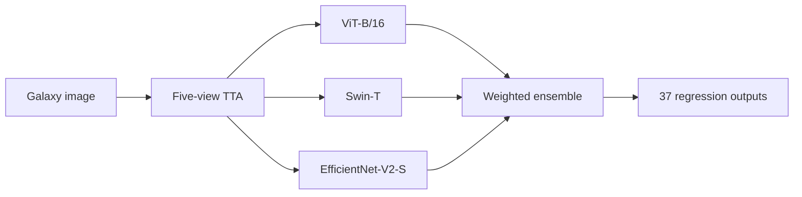

# Galaxy Morphology — Transformer / CNN Ensemble

基于 **Python / PyTorch** 的星系形态识别课程项目：使用 **ViT-B/16、Swin-T、EfficientNet-V2-S** 进行迁移学习，通过三模型加权集成和五视角测试时增强（TTA），预测 Galaxy Zoo 图像的37维形态标注。

A physics undergraduate machine-learning coursework project, completed in April 2026. This repository contains a cleaned, unexecuted copy of the training and analysis notebook, plus metrics recorded in the original local experiment.

## 项目内容

- 图像加载、224×224中心裁剪、归一化、随机旋转与水平/垂直翻转。
- 三种预训练视觉骨干网络，每个模型连接11个独立线性任务头，共37个回归输出。
- AdamW、余弦退火、AMP混合精度、梯度累积与梯度裁剪；CNN训练使用Huber loss。
- 推断时采用原图、水平翻转、垂直翻转及两种旋转，共五个视角。
- ViT / Swin / CNN 按0.55 / 0.30 / 0.15加权融合，进行分任务误差、残差、校准及失败样本分析。



## 原实验验证结果

数据按80%训练、20%验证划分，`random_state=42`。以下结果来自原始Notebook保存的输出；整理仓库时没有重新训练。

| 指标 | 原本地验证集结果 |
| --- | ---: |
| 全局RMSE | 0.07418 |
| 根节点分类准确率 | 88.28% |
| R²（多输出均匀平均） | 0.6770 |
| 逐图像Pearson相关系数均值 | 0.9472 |
| 逐图像余弦相似度均值 | 0.9609 |

这些是**本地验证集**结果，不是Kaggle官方测试集成绩，不能据此宣称比赛排名或超过排行榜选手。根节点准确率只评价前三个输出中最大值对应的类别。

原始逐轮单模型验证损失保存在 [`results/training_history.json`](results/training_history.json)，指标与来源说明保存在 [`results/validation_metrics.json`](results/validation_metrics.json)。

## 文件结构

```text
notebooks/galaxy_morphology.ipynb   # 训练、集成推断与分析
results/validation_metrics.json    # 原实验保存的验证指标
results/training_history.json      # 从原训练日志提取的单模型历史
docs/PROJECT_NOTES.md              # 项目来源、整理变更与局限
requirements.txt                  # 依赖名称，非原环境锁文件
```

## 运行准备

1. 准备Python环境，按[PyTorch官方安装页](https://pytorch.org/get-started/locally/)选择匹配本机CUDA的`torch`和`torchvision`。原实验使用RTX 5070 Laptop GPU（8GB显存），每个模型训练15轮。CPU流程未验证。
2. 安装其余依赖：`python -m pip install -r requirements.txt`。
3. 从[Galaxy Zoo — The Galaxy Challenge](https://www.kaggle.com/competitions/galaxy-zoo-the-galaxy-challenge/data)自行获取训练数据，并遵循数据提供方的使用条件。仓库不附带数据集或模型权重。
4. 将数据放到下面的结构，或将`GALAXY_DATA_DIR`环境变量设为包含CSV和图像文件夹的绝对路径。

```text
data/
  training_solutions_rev1.csv
  images_training_rev1/
    <GalaxyID>.jpg
```

5. 从仓库根目录运行`jupyter lab`，打开`notebooks/galaxy_morphology.ipynb`，按顺序执行。首次加载预训练骨干网络需要联网下载权重。训练产生的权重写入`checkpoints/`，不会提交到Git。

## 方法局限

这是课程实验，尚未作为生产服务部署。11个任务头是独立回归头，没有硬性施加概率归一化或父子条件约束；五视角TTA、数据划分和集成权重也不构成独立测试评估。重新运行时结果会受到硬件、依赖版本及随机性影响。

原报告披露使用生成式AI辅助部分可视化代码、TTA张量操作与文字整理/翻译。本公开版保留这一来源说明。更多细节见[项目说明](docs/PROJECT_NOTES.md)。
