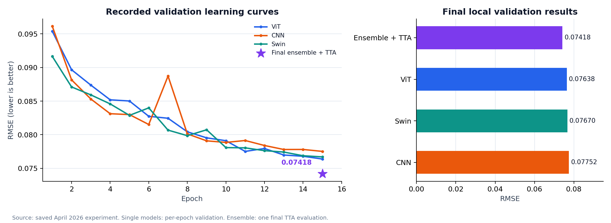
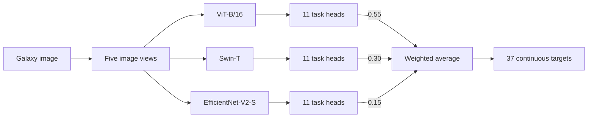
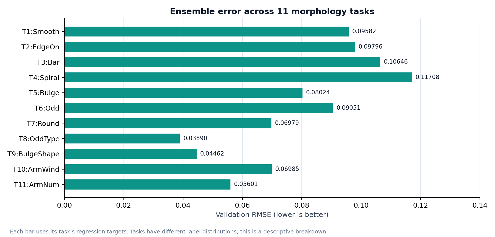

# Galaxy Morphology Ensemble

[](https://github.com/AL1ghtm3ter/galaxy-morphology-ensemble/actions/workflows/ci.yml)

**用 Transformer 与 CNN 预测星系形态，完成从图像处理、模型训练到集成推断和误差分析的课程实验。**

Python · PyTorch · ViT-B/16 · Swin-T · EfficientNet-V2-S

基于 Galaxy Zoo 图像的 **37维志愿者投票比例回归**。三个预训练视觉模型分别连接11个任务头，通过五视角测试时增强（TTA）和加权融合获得最终预测。

## 实验结果



| 方法 | 本地验证集 RMSE ↓ |
| --- | ---: |
| ViT-B/16 | 0.07638 |
| Swin-T | 0.07670 |
| EfficientNet-V2-S | 0.07752 |
| **三模型加权集成 + 五视角 TTA** | **0.07418** |

原实验于2026年4月完成，使用80%训练 / 20%验证划分，`random_state=42`。表格和图表来自当时保存的训练记录；星标只表示最终一次集成评估，没有构造逐轮集成曲线。单模型行是未使用TTA的验证结果，最后一行同时包含集成和TTA的效果。

根节点三类输出的 argmax 准确率为 **88.28%**。完整数值见[验证指标](results/validation_metrics.json)，逐轮记录见[训练历史](results/training_history.json)。这些属于本地验证结果，不能换算成比赛排名。

## 方法



- **数据处理：**224×224中心裁剪、ImageNet归一化、随机旋转及水平/垂直翻转。
- **训练：**AdamW、余弦退火、混合精度、梯度累积与梯度裁剪；CNN使用Huber loss。
- **推断：**原图、水平翻转、垂直翻转、90°和180°旋转，共五个视角。
- **分析：**全局与分任务RMSE、残差、校准和高误差样本检查。

架构采用独立线性回归头，没有硬性施加父子概率约束。任务定义与评估口径见[方法说明](docs/METHOD.md)。

## 快速查看结果

**不需要GPU或数据集**即可重画上面的真实记录图表：

```bash
git clone https://github.com/AL1ghtm3ter/galaxy-morphology-ensemble.git
cd galaxy-morphology-ensemble
python -m pip install -e ".[viz]"
python scripts/plot_results.py
```

生成图片位于 `assets/figures/`。运行训练前，建议创建独立Python环境，并按[复现指南](docs/REPRODUCING.md)安装匹配本机的PyTorch和数据依赖。

## 训练、评估与预测

准备数据和 `.[train]` 依赖后，在仓库根目录执行：

```bash
galaxy-morphology train --model vit --data-dir data --output-dir runs/vit
galaxy-morphology train --model swin --data-dir data --output-dir runs/swin
galaxy-morphology train --model efficientnet --data-dir data --output-dir runs/efficientnet
```

三个模型训练完成后，使用同一组验证样本进行加权TTA评估：

```bash
galaxy-morphology evaluate --data-dir data --checkpoints runs/vit/best.pt runs/swin/best.pt runs/efficientnet/best.pt --weights 0.55 0.30 0.15 --output runs/ensemble.json
```

也可以只使用一个模型预测单张图片：

```bash
galaxy-morphology predict --image data/images_training_rev1/100008.jpg --checkpoints runs/vit/best.pt --output runs/prediction.json
```

已有课程项目的原始 `.pth` 权重，可用 `import-legacy` 转成命令行工具使用的检查点，示例见[复现指南](docs/REPRODUCING.md#导入原课程权重)。

## 分任务表现



不同任务的标签分布不同，图表用于展示误差分布，不代表任务难度的统一量尺。

## 代码结构

```text
src/galaxy_morphology/
  data.py          CSV检查、固定划分、图像读取与增强
  models.py        三种视觉骨干与11个回归头
  engine.py        训练循环与验证
  inference.py     五视角TTA与加权集成
  metrics.py       全局、根节点及分任务指标
  checkpoints.py   模型与验证样本信息的保存和加载
  cli.py           train / evaluate / predict / import-legacy
configs/           原实验超参数
notebooks/         课程流程参考Notebook
results/           原实验保存的指标与训练历史
assets/figures/    可由脚本重画的结果图
tests/             无需联网、无需下载权重的CPU检查
docs/              方法、复现、验证与来源说明
```

## 检查与复现范围

```bash
python -m unittest discover -s tests -v
```

检查覆盖三种真实骨干的前向输出、五视角变换、梯度累积尾批、严格数据读取、检查点往返，以及小型数据上的训练→评估→预测流程。GitHub Actions 在CPU环境中运行同一组检查，不下载数据集或预训练权重。

本地检查记录见[验证说明](docs/VALIDATION.md)。仓库整理没有重新执行完整的三模型GPU训练；新运行的输出写入 `runs/`，与保留在 `results/` 的原实验记录分开。

## 项目背景

原实验来自布里斯托大学物理本科的高级计算物理与机器学习课程。2026年11月增加了模块化命令行工具、测试和结果可视化，便于代码阅读与后续复现。

[项目来源与整理记录](docs/PROJECT_NOTES.md)包含原实验、AI辅助使用说明，以及公开版的具体变更。数据集和模型权重需自行获取，仓库不附带第三方数据。

### English overview

A physics undergraduate coursework project for 37-output Galaxy Zoo morphology regression. It combines ViT-B/16, Swin-T and EfficientNet-V2-S with five-view TTA and weighted prediction averaging. The repository includes a modular PyTorch CLI, offline CPU checks, reproducible plots of the recorded experiment, and a reference notebook. The archived 0.07418 RMSE is a local validation result, not an official competition test score.
